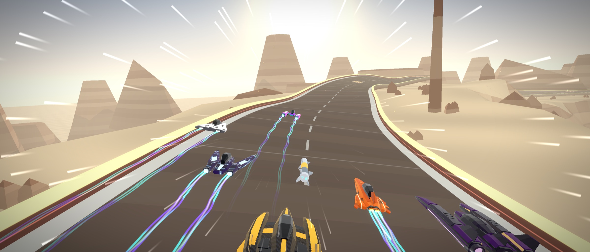
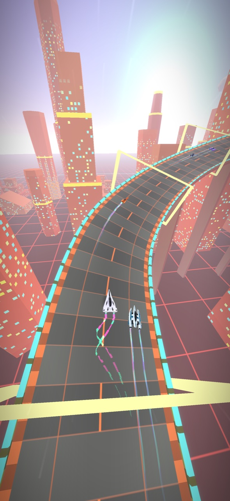
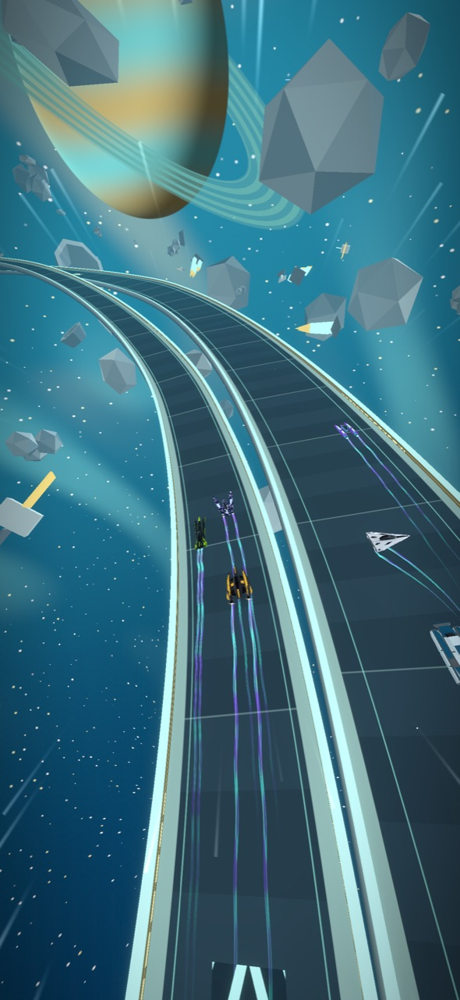
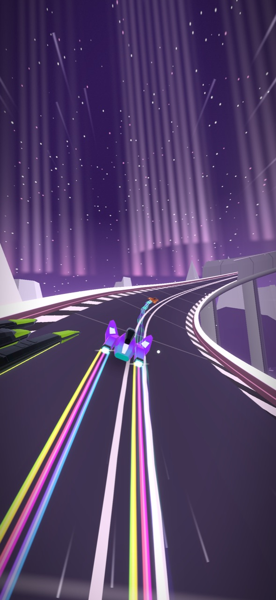
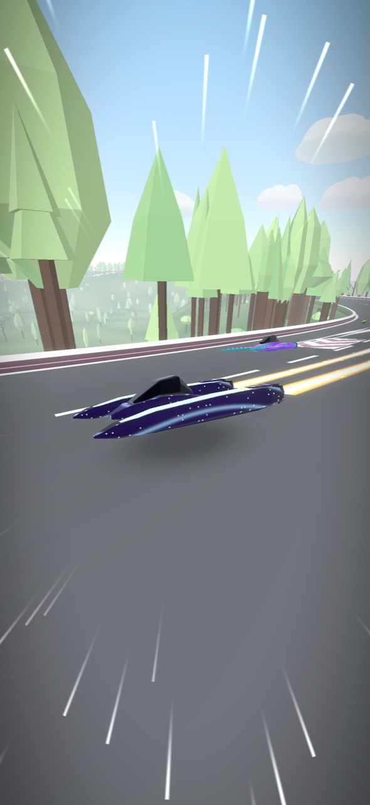
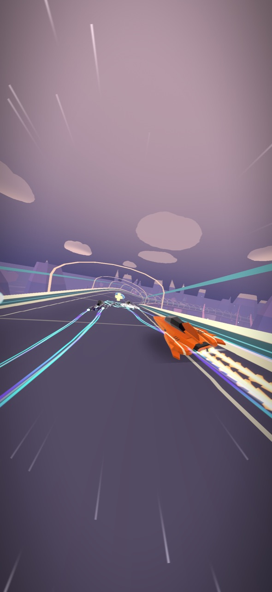

  

<h1 align="center">Slipline Racing</h1>

  Anti-gravity racing for iPhone and iPad. 
  <a href="https://brandonmherbert-apps.github.io/slipline-racing/"><b>Visit the website</b></a>

  
  
  
  
  

## The game

Race anti-gravity craft across neon-lit cities, snowy mountains, forest roads, and underwater tunnels. Fly above the clouds, navigate sharp turns, and race along the curve of a planet.

### Three ways to race

**Race:** Compete against seven rivals using items and weapons to fight for first place.

**Time Trial:** Race against the clock, improve your racing lines, and beat your personal best.

**Surge:** Keep racing as the speed steadily increases. Survive as long as you can before crashing.

### Career and customization

Work your way through Career Mode, earn medals, and unlock new craft, paints, exhaust effects, and app icons.

Take on a new Daily Challenge and five daily missions, or head into Arcade to choose your own circuit and game mode.

### Play your way

Arcade includes Chill Mode for a more relaxed experience. Adjust reduced motion, reduced flashes, and battery saver options in Settings.

### Records and achievements

Compete on Game Center leaderboards, unlock achievements, and track your best times across every circuit. Your progress syncs between devices through iCloud.

## Price

Slipline Racing features eight circuits and four permanent Career tiers. Four circuits and Rookie Career are available for free, with the remaining circuits and Career tiers available through a one-time Core Game purchase.

Earn craft and cosmetics through gameplay. No subscriptions.

## Links

- [App Store](https://apps.apple.com/us/app/slipline-racing/id6822549455)
- [Website](https://brandonmherbert-apps.github.io/slipline-racing/)
- [Support](support.txt)
- [Privacy policy](privacy-policy.txt)

© 2026 Brandon Herbert
